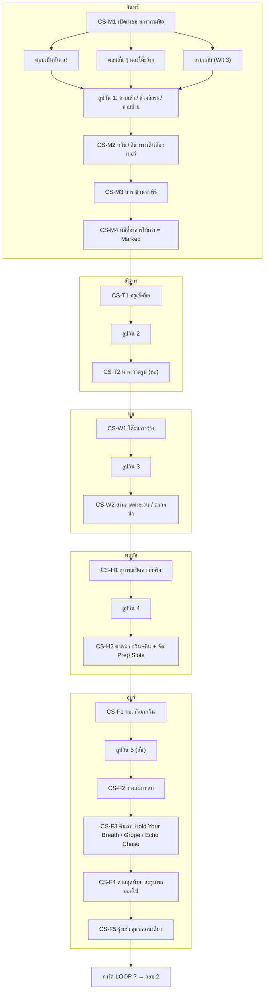

# MNEMOSYNE — แผนผังตัวเลือก รอบที่ 1 (กวิน) จันทร์–ศุกร์

สถานะ: **ข้อเสนอ ยังไม่ใช่แคนอน** ตัวเลขทั้งหมดเป็นค่าตั้งต้นสำหรับปรับสมดุล
อ้างอิง: `MNEMOSYNE_design_bible.md` (หัวข้อ 4, 5), `MNEMOSYNE_night_events_spec.md`, `MNEMOSYNE_location_screen_spec.md`, `MNEMOSYNE_cutscene_flow_architecture.md`
ภาพอ้างอิงสำหรับทำวิดีโออยู่ที่ `bible\characters_v2\`, `bible\staff_v2\`, `bible\locations\`

---

## 0. หลักการของรอบนี้

- **ตัวเอก:** กวิน (หลานผอ. รู้ความลับองค์กรเลือนราง) คู่หู: ลิน ตัวช่วยฝั่งความรู้: ขุนพล นกต่อ: นารา
- **สื่อกลางของ Entity-0 รอบนี้:** เสียงสะท้อน (ตรงกับบรรยากาศบทเปิด และ Hold Your Breath)
- **ฉากจบถูกล็อก (Bad/True End 1):** กวินและลินตายคืนวันศุกร์ ขุนพลรอด **ผู้เล่นเปลี่ยนไม่ได้ว่าใครตาย** แต่ตัวเลือกเปลี่ยน
  1. สิ่งที่ผู้เล่นรู้ (Codex) และสิ่งที่ขุนพลได้รับต่อไป (ของที่ส่งต่อข้ามรอบ)
  2. ความสัมพันธ์กับนารา ลิน ขุนพล
  3. ฉากไหนเล่นและเล่นอย่างไรในคืนวันศุกร์ (ความยาวของฉากสุดท้าย คำพูดสุดท้าย)
  4. ระดับบทบาทของขุนพลในรอบ 2 (บทน้อย → บทสำคัญ)
- ตัวเลือกที่ผู้เล่น "รู้สึกว่ามีผล" ต้องมีผลจริง อย่างน้อยหนึ่งอย่างจาก 1–4

### 0.1 ค่าเริ่มต้นของกวิน
| ตัวแปร | ค่า | หมายเหตุ |
|---|---|---|
| Composure / Wit / Strength | 2 / 3 / 1 | Wit 3 เพราะกวินรู้เรื่ององค์กรเล็กน้อย |
| Suspicion | 10 | ค่าตั้งต้นเดิมของโปรโตไทป์ |
| Affection | นารา 0, ลิน 2, ขุนพล 1 | ลินสนิทแล้ว ขุนพลเป็นเพื่อนร่วมสภานักเรียน |
| ไอเทมตั้งต้น | เข็มกลัดเงิน (`has_pin`) | ของที่ขุนพลจะเก็บไว้ |

### 0.2 พจนานุกรม flag สำคัญ
| flag | ความหมาย | ได้จาก |
|---|---|---|
| `told_name` | ตอบชื่อนาราแล้ว | จันทร์ |
| `asked_nara_before` | ถามนาราว่าเคยเจอกันหรือไม่ | จันทร์ |
| `lin_pills_known` | รู้ว่ายาของลินต้านสาร | จันทร์ |
| `ritual_eager` / `ritual_reluctant` | ท่าทีตอนไปพิธี | จันทร์ |
| `held_lin` | จับมือลินระหว่างพิธี | จันทร์ |
| `marked` | ถูกตีตรา (ทุกเส้นทางจะได้) | จันทร์ |
| `asked_teacher` | ถามครูเรื่องโต๊ะว่าง | อังคาร |
| `has_nara_drawing` | เก็บภาพวาดนารา | อังคาร |
| `sector0_clue` | รู้ว่ามีห้อง/ประตูใต้ถุน | อังคาร |
| `echo_known` | รู้ว่าสื่อกลางคือเสียงสะท้อน | อังคาร/พฤหัส |
| `guard_route_known` | รู้เส้นทางยาม | พุธ |
| `water_passed_clean` | ผ่านตรวจน้ำโดยไม่ดื่มสาร | พุธ |
| `drank_chemical` | ดื่มสาร (เลือนหลักฐาน 1–2 ใบ) | พุธ |
| `nara_decoy_known` | รู้ว่านาราคือนกต่อ | พฤหัส |
| `has_pills` | ได้ยาของลิน | พฤหัส |
| `plan_classroom` / `plan_basement` / `plan_split` | แผนหลบคืนวันศุกร์ | ศุกร์ |
| `uncle_confronted` | เผชิญหน้า ผอ. | ศุกร์ |

---

## 1. ภาพรวมทั้งสัปดาห์

โครงตามเวลาจริงของโปรโตไทป์: คาบเช้า → ช่วงอิสระ 1 → คาบบ่าย → ช่วงอิสระ 2 → กลางคืน คัทซีน "CS-xN" ที่ลงท้ายด้วยตัวเลขวัน (M=จันทร์ T=อังคาร W=พุธ H=พฤหัส F=ศุกร์) แทรกที่จุดที่ระบุในแต่ละวัน

---

## 2. วันจันทร์ — ตีตรา

### CS-M1 เปิดเทอม นาราถามชื่อ
**จุดแทรก:** ต้นวันจันทร์ ก่อนคาบเช้า | **ฉาก:** ห้องเรียน ม.5/3 มุม FPS | **วิดีโอ:** `mon_intro_nara` (มีแล้ว ปรับบท)

**บทหลัก**
> นารา: *(โบกมือ)* นายมาใหม่นี่ นายชื่ออะไร
> *(ช่องชื่อเติมเองเป็น "กวิน" ผู้เล่นไม่มีตัวเลือกเรื่องชื่อ)*

| # | ตัวเลือก | เงื่อนไข | ผล | ไปที่ |
|---|---|---|---|---|
| 1 | "กวิน เรียกกวินก็ได้" (เป็นกันเอง) | – | Aff นารา +1, flag `told_name` | M1-a |
| 2 | "กวิน" แล้วหันไปมองโต๊ะว่างริมหน้าต่าง | – | Composure +1, flag `noticed_empty_desk` | M1-b |
| 3 | "เธอเคยเจอฉันมาก่อนหรือเปล่า" | Wit 3 | Aff นารา +1, Codex "นารารู้สึกว่าเคยคุยกับกวินมาก่อน ทั้งที่เธอไม่ควรจำได้", flag `asked_nara_before` | M1-c |

**บทตอบสนอง**
> **M1-a**
> นารา: กวิน... ชื่อเพราะจัง ฉันจะจำให้ได้นะ
> *(เธอก้มดูสมุดในอ้อมแขน แล้วเงยขึ้นมาอีกครั้ง)*
> นารา: แปลกจัง รู้สึกเหมือนเคยพูดประโยคนี้มาแล้ว
>
> **M1-b**
> นารา: *(มองตามสายตากวินไปที่โต๊ะว่าง)* โต๊ะนั้นเหรอ ว่างอยู่ตั้งแต่ฉันมา
> นารา: แต่ฝุ่นไม่หนาเลยนะ ตลกดีเนอะ
> *(เธอยิ้ม แต่ไม่กะพริบตา)*
>
> **M1-c**
> *(รอยยิ้มของนาราค้างไปครู่หนึ่ง)*
> นารา: ...เคยเหรอ
> นารา: *(เบาลง)* ฉันก็รู้สึกแบบนั้น แต่คิดว่าเป็นเพราะตื่นเต้นมากกว่า

**ผลต่อเนื่อง:** ทั้งสามกลับเข้า **ลูปวันจันทร์** (คาบเช้า)

---

### CS-M2 กวินกับลินในทางเดินล็อกเกอร์
**จุดแทรก:** หลังคาบบ่าย ก่อนช่วงอิสระ 2 | **ฉาก:** ทางเดินล็อกเกอร์ | **วิดีโอ:** `route1_kwin_lin_corridor_kling4_8s` (มีแล้ว)

**บทหลัก (วิดีโอ)**
> ลิน: *(กระซิบ)* กวิน... โต๊ะริมหน้าต่างตัวนั้น เมื่อวานมีคนนั่งอยู่ใช่ไหม
> กวิน: ...ใช่ ฉันก็จำได้

| # | ตัวเลือก | เงื่อนไข | ผล | ไปที่ |
|---|---|---|---|---|
| 1 | "เราต้องหาให้ได้ว่าเกิดอะไรขึ้น" | – | Aff ลิน +1, flag `investigating` | M2-a |
| 2 | "อย่าบอกใครเรื่องนี้ ฉันกลัวมีคนฟังอยู่" | – | Suspicion −3, Composure +1, flag `secret_pact` | M2-b |
| 3 | "เธอกินยาอะไรอยู่ ทำไมเธอจำได้" | Aff ลิน ≥ 2 | Aff ลิน +1, Codex "ยาของลินดูเหมือนจะทำให้เธอจำได้", flag `lin_pills_known` | M2-c |

**บทตอบสนอง**
> **M2-a**
> ลิน: *(พยักหน้าช้า ๆ)* ฉันไม่รู้จะเริ่มจากตรงไหน แต่ถ้ามีนายอยู่ด้วย ฉันกล้าขึ้นหน่อย
> กวิน: เริ่มจากโต๊ะนั้นก่อน
>
> **M2-b**
> ลิน: *(มองไปรอบทางเดิน)* ...นายก็ระแวงเหมือนกันเหรอ
> กวิน: ลุงฉันบอกเสมอว่าที่นี่มีหูอยู่ทุกที่ ฉันเพิ่งเริ่มเข้าใจว่าท่านไม่ได้พูดเล่น
>
> **M2-c**
> ลิน: *(กำพวงกุญแจขวดยาแน่น)* ...วิตามิน
> กวิน: ลิน
> ลิน: *(เสียงสั่น)* หมอบอกว่าห้ามหยุดกิน ฉันเลยไม่เคยหยุด แล้วฉันก็จำเรื่องที่คนอื่นลืมได้ ฉันไม่เคยบอกใครมาก่อน

---

### CS-M3 นาราชวนทำพิธี
**จุดแทรก:** ช่วงอิสระ 2 จบ ก่อนกลางคืน | **ฉาก:** ห้องเรียน/หอ ตอนเย็น | **ตัวละคร:** นารา ลิน กวิน ขุนพล | **วิดีโอ:** `mon_ritual_invite` (ต้องทำใหม่)

**บทหลัก (วิดีโอ)**
> นารา: ถ้าอยากรู้ว่าคนที่หายไปคือใคร ฉันรู้วิธีนะ
> ลิน: วิธีอะไร
> นารา: พิธีติดต่ออีกฝั่ง ไม่อันตรายหรอก แค่ถามว่า "เขาคือใคร" แล้วฟังคำตอบ
> ขุนพล: *(ขมวดคิ้ว)* พิธีแบบนี้ไม่ควรทำโดยไม่รู้ว่าใครเป็นคนสอนเธอ
> นารา: *(ยิ้ม)* ฉันอ่านเจอ ในห้องสมุด

| # | ตัวเลือก | เงื่อนไข | ผล | ไปที่ |
|---|---|---|---|---|
| 1 | "ไปสิ ฉันอยากรู้" | – | Aff นารา +1, flag `ritual_eager` | M3-a |
| 2 | "ได้ แต่ให้ขุนพลตรวจดูก่อน" | Aff ขุนพล ≥ 1 | Aff ขุนพล +1, flag `khun_researching` (วันพฤหัส ขุนพลเปิดข้อมูลได้มากขึ้น) | M3-b |
| 3 | "ไม่ไป มันไม่ปลอดภัย" | – | Aff ลิน −1, Aff นารา −1, flag `ritual_reluctant`, Suspicion +3 | M3-c |

**บทตอบสนอง** (ทุกทางไปจบที่พิธี)
> **M3-a**
> นารา: *(ตาเป็นประกาย)* ดีเลย คืนนี้นะ ที่อาคารไม้เก่า
> ขุนพล: ...ฉันจะไปด้วย แต่ถ้ามีอะไรผิดปกติ หยุดทันที
>
> **M3-b**
> ขุนพล: *(เงียบครู่หนึ่ง แล้วพยักหน้า)* ให้เวลาฉันถึงค่ำ ฉันจะเช็กว่าพิธีแบบนี้มีบันทึกที่ไหนบ้าง
> นารา: *(ยิ้มแข็ง)* แน่นอน ฉันไม่รีบ
> *(สีหน้านาราเปลี่ยนไปเล็กน้อยตอนเอ่ยคำว่า "ไม่รีบ")*
>
> **M3-c**
> ลิน: ถ้านายไม่ไป ฉันก็ไปคนเดียวได้ ฉันอยากรู้จริง ๆ
> กวิน: ...ลิน
> ลิน: ขอโทษ ฉันไม่ได้ตั้งใจจะตัดสินใจแทนนาย แต่ฉันจะไม่ถอย
> *(กวินถอนหายใจ แล้วเดินตามไป ไม่พูดอะไรอีก)*

---

### CS-M4 พิธีที่อาคารไม้เก่า (ตีตรา)
**จุดแทรก:** กลางคืนวันจันทร์ | **ฉาก:** อาคารไม้เก่า วงเทียน | **ตัวละคร:** นารา กวิน ลิน ขุนพล | **วิดีโอ:** `mon_ritual_night` 12 วิ + `mon_marked` 6 วิ (ต้องทำใหม่)

**บทหลัก (วิดีโอ)**
> นารา: *(เสียงเบา)* ทุกคนจับมือกัน คิดถึงคนที่หายไปแล้วถามในใจ "เขาคือใคร"
> *(เปลวเทียนเอนไปทางมุมมืด กระจกมือแตกเป็นเส้น เสียงสะท้อนซ้อนเสียงนารา)*
> เสียงสะท้อน: ...เขาคือใคร... เขาคือใคร... เขาคือใคร...
> ขุนพล: *(สะดุ้ง)* หยุด!

| # | ตัวเลือก | เงื่อนไข | ผล | ไปที่ |
|---|---|---|---|---|
| 1 | พูดความจริง "ฉันไม่รู้ชื่อเขา แต่ฉันจำเขาได้" | – | Composure +1, Codex "พิธีต้องการชื่อ แต่เอนทิตีรับคำถามเป็นคำเรียก" | M4-a |
| 2 | ตั้งชื่อให้ตามความรู้สึก | Wit 3 | flag `ritual_named` (ใช้ในคืนศุกร์: ขุนพลเรียกชื่อเดียวกัน) | M4-b |
| 3 | ไม่พูด จับมือลินไว้แน่น | – | Aff ลิน +2, flag `held_lin` | M4-c |

**บทตอบสนอง**
> **M4-a**
> กวิน: ฉันไม่รู้ชื่อเขา แต่ฉันจำเขาได้ เขาเคยนั่งโต๊ะริมหน้าต่าง
> *(เสียงสะท้อนหยุด ทุกคนนิ่งไปชั่วอึดใจ)*
> นารา: *(กระซิบ)* ...พอแล้วค่ะ
>
> **M4-b**
> กวิน: *(ตั้งสติ)* ฉันขอเรียกเขาว่า "ผู้ที่นั่งริมหน้าต่าง"
> *(เสียงสะท้อนทวนประโยคนั้นหลายครั้ง ช้าลงเรื่อย ๆ จนกลายเป็นเสียงกระซิบ)*
> ขุนพล: *(แผ่วเบา)* ทำไมมันถึงทวนตามนาย...
>
> **M4-c**
> *(มือของลินเย็นเฉียบ เธอบีบตอบแรง ๆ)*
> ลิน: *(กระซิบ)* กวิน ฉันอยู่ตรงนี้
> กวิน: ฉันก็อยู่

**ฉากปิด (ทุกเส้นทาง)**
> *(เทียนดับพร้อมกันทุกเล่ม ข้อมือซ้ายของกวินและลินมีรอยสีซีดประทับ นาราจ้องมองรอยนั้นแล้วยิ้มเบา ๆ)*
> นารา: ขอบคุณที่มานะ
> ขุนพล: นารา เธอ...
> *(นาราเดินออกจากวงเทียนโดยไม่หันกลับมา)*

**ผล (ทุกทาง):** flag `marked`, หน้าจอการ์ด "ตีตราแล้ว" **ผู้เล่นรู้เฉพาะว่าถูกตีตรา ไม่ทราบความหมายจนวันพฤหัส**

---

## 3. วันอังคาร — ภาพวาดของนารา

### CS-T1 ครูเช็คชื่อ
**จุดแทรก:** คาบเช้า | **ฉาก:** ห้องเรียน | **ตัวละคร:** ครูประจำชั้น | **วิดีโอ:** `tue_roll_call` 6 วิ (ต้องทำใหม่)

**บทหลัก (วิดีโอ)**
> ครู: เช้านี้ครบทุกคนนะ
> *(สายตาครูหยุดที่โต๊ะว่างริมหน้าต่าง ปากกาแดงขีดเส้นลงในสมุด แล้วเลื่อนต่อ)*
> ครู: ...เริ่มเรียนได้

| # | ตัวเลือก | เงื่อนไข | ผล | ไปที่ |
|---|---|---|---|---|
| 1 | ยกมือถาม "ครูครับ โต๊ะตัวนั้นของใคร" | – | Suspicion +8, flag `asked_teacher` | T1-a |
| 2 | นั่งนิ่ง สังเกตสมุดเช็คชื่อ | Composure 2 | Codex "ครูขีดชื่อด้วยปากกาแดงทุกเช้า", Suspicion +0 | T1-b |
| 3 | หันไปมองนารา | – | flag `nara_avoids_eye` | T1-c |

**บทตอบสนอง**
> **T1-a**
> ครู: *(ไม่เงยหน้า)* ไม่มีโต๊ะไหนที่ไม่มีเจ้าของหรอกนะกวิน
> กวิน: แต่...
> ครู: นั่งลง
> *(ทั้งห้องเงียบ ลินเหลือบมองกวินอย่างกังวล)*
>
> **T1-b**
> *(กวินเห็นว่าสมุดมีหน้าที่ถูกขีดฆ่าด้วยปากกาแดงเป็นแถว ชื่อบางชื่อถูกขีดซ้ำหลายรอบ ก่อนครูจะปิดสมุด)*
> กวิน: *(ในใจ)* ไม่ใช่ครั้งแรก
>
> **T1-c**
> *(นาราก้มหน้าเขียนอะไรบางอย่าง ไม่มองกลับ ปลายนิ้วของเธอสั่นเล็กน้อย)*
> กวิน: *(ในใจ)* เมื่อวานเธอยิ้มให้ฉัน

**ผล:** เข้าลูปวันอังคาร

---

### CS-T2 นารานั่งวาดรูปที่โถงหอ
**จุดแทรก:** กลางคืนวันอังคาร | **ฉาก:** หอพัก โถงกลาง | **วิดีโอ:** `tue_nara_drawing` 8 วิ (ลูปเสียงปากกา) + `tue_nara_confused` 6 วิ (ต้องทำใหม่)

**บทหลัก**
> *(นารานั่งวาดรูปคนเดียวใต้แสงเหลืองสลัว หมอกกดกระจก)*
> นารา: อ้าว กวิน มาดูสิ ฉันวาดทางเดินยาว ๆ ที่ไม่เคยไปเลย แปลกดีเนอะ
> *(ภาพคือทางเดินสีขาวสะอาด มีประตูเหล็กหนักเรียงต่อกัน)*

| # | ตัวเลือก | เงื่อนไข | ผล | ไปที่ |
|---|---|---|---|---|
| 1 | "สวยดี วาดอะไรเหรอ" | – | Aff นารา +1 | T2-a |
| 2 | สังเกตรายละเอียดของภาพ | Wit 2 | Codex "ทางเดินในภาพวาดของนาราไม่ตรงกับตึกไหนของโรงเรียน", flag `sector0_clue` | T2-b |
| 3 | "ขอเก็บภาพนี้ไว้ได้ไหม" | – | ได้ไอเทม **ภาพวาดนารา** (`has_nara_drawing`), Suspicion +5 ถ้ายามเห็นตอนพก | T2-c |
| 4 | "เธอจำอะไรได้บ้างก่อนมาที่นี่" | Aff นารา ≥ 2 | Codex "นารารีเซ็ตทุกรอบ", Aff นารา +1 | T2-d |
| 5 | เงียบ ฟังเสียงรอบตัว | Composure 2 | Codex "เสียงสะท้อนจากท่อ: ใบ้สื่อกลางของ Entity-0", flag `echo_known` | T2-e |

**บทตอบสนอง**
> **T2-a**
> นารา: ฉันก็ไม่รู้ มือมันขยับเอง *(หัวเราะเบา ๆ)* ลืมไปเลยว่าเคยฝันถึงที่แบบนี้
> กวิน: ฝันบ่อยเหรอ
> นารา: ทุกคืน แต่ตื่นมาก็ลืมหมด
>
> **T2-b**
> *(กวินเห็นว่าพื้นในภาพเป็นกระเบื้องสะอาดมากเกินไป และมีป้ายเลขที่ไม่ตรงกับห้องไหนในอาคาร)*
> กวิน: นารา ที่นี่คือที่ไหน
> นารา: *(มองภาพ หน้าซีดลง)* ฉันไม่รู้... แต่รู้สึกเหมือนเคยเดินผ่าน
>
> **T2-c**
> นารา: เอาไปสิ ฉันวาดใหม่ได้
> *(เธอฉีกหน้ากระดาษให้ ปลายนิ้วเปื้อนหมึก)*
> นารา: ถ้าวันไหนฉันลืมว่าวาดอะไร ก็ช่วยบอกที
>
> **T2-d**
> นารา: ก่อนมาที่นี่เหรอ... *(นิ่งไป ดินสอหยุดกลางอากาศ)*
> นารา: ฉัน... *(สีหน้าสับสนวูบหนึ่ง)* ขอโทษ ลืมไปว่ากำลังพูดอะไรอยู่
> *(เธอจ้องภาพวาดอย่างหวาดกลัวเล็กน้อย)*
>
> **T2-e**
> *(ท่อน้ำใต้พื้นส่งเสียงสะท้อนผิดจังหวะ ซ้อนกับเสียงปากกาขีด)*
> กวิน: *(ในใจ)* เสียงนี้... เหมือนเสียงในพิธี
> นารา: *(เงยหน้า)* กวินเหรอ ได้ยินอะไรหรือเปล่า
> กวิน: เปล่า

**ฉากปิด (ทุกเส้นทาง)**
> นารา: ฉันอาจไม่ได้มาเรียนสองสามวันนะ ไม่สบายนิดหน่อย
> นารา: อย่าลืมฉันล่ะ
> *(เธอยิ้ม คำว่า "อย่าลืมฉัน" ฟังเหมือนขอร้อง)*

**ผล:** นาราหายจากโรงเรียนตั้งแต่พุธ

---

## 4. วันพุธ — ตรวจน้ำ

### CS-W1 โต๊ะนาราว่าง
**จุดแทรก:** เช้าวันพุธ | **ฉาก:** ห้องเรียน | **รูปแบบ:** ภาพนิ่ง + ข้อความ (ไม่ต้องทำวิดีโอ)

**บทหลัก**
> *(โต๊ะของนาราว่าง กระเป๋าและสมุดไม่อยู่ ลินมองโต๊ะแล้วมองกวิน)*
> ลิน: นารายังไม่มา
> ครู: *(ขีดปากกาแดงแล้วเลื่อนผ่านชื่อ)* วันนี้ขาดหนึ่งคน

| # | ตัวเลือก | เงื่อนไข | ผล | ไปที่ |
|---|---|---|---|---|
| 1 | ถามเพื่อนร่วมห้องว่านาราไปไหน | – | Suspicion +3 | W1-a |
| 2 | ไปห้องหอนาราหลังเลิกเรียน | – | เสียเวลา 1 ช่วงอิสระ, flag `visited_nara_dorm` | W1-b |
| 3 | ปล่อยไป แล้วเฝ้าดูลิน | – | Aff ลิน +1 | W1-c |

**บทตอบสนอง**
> **W1-a**
> เพื่อนร่วมห้อง: นารา ใครนะ เด็กใหม่คนนั้นเหรอ ไม่เห็นมาตั้งแต่เช้า
> เพื่อนร่วมห้อง: แต่เมื่อวานเธอก็ยังอยู่เลยนี่ เอ๊ะ
> *(เขาขมวดคิ้ว เหมือนเรื่องที่ตัวเองพูดไม่ตรงกับความจำ)*
>
> **W1-b**
> *(ห้องของนาราสะอาดเรียบร้อย เตียงไม่มีรอยนอน บนโต๊ะมีเพียงดินสอแท่งเดียว)*
> กวิน: *(ในใจ)* เหมือนห้องที่ไม่เคยมีใครอยู่
> *(ดินสอวางทับกระดาษที่มีลายเส้นจาง ๆ ของทางเดินสีขาว)*
>
> **W1-c**
> ลิน: *(ลดเสียง)* กวิน นายเป็นอะไรหรือเปล่า
> กวิน: ไม่เป็นไร แค่คิดถึงเรื่องเมื่อคืน
> ลิน: ถ้านายต้องการคนฟัง ฉันอยู่ตรงนี้นะ

---

### CS-W2 ยามลาดตระเวน / ตรวจน้ำ
**จุดแทรก:** กลางคืนวันพุธ | **ฉาก:** ทางเดินล็อกเกอร์ + โรงอาหาร | **วิดีโอ:** `wed_guard_patrol` 8 วิ มุม POV จากล็อกเกอร์ (ต้องทำใหม่) + มินิเกม Hold Your Breath แบบย่อ

**เงื่อนไขเข้าเหตุการณ์ (ตามระดับ Suspicion)**
| Suspicion | เหตุการณ์ |
|---|---|
| 0–29 | ยามเดินผ่าน เลือกหลบหรือไม่ก็ได้ ไม่มีโทษ ใช้สังเกตเส้นทาง (`guard_route_known`) |
| 30–59 | ตรวจน้ำ (ตารางข้อ W2-A) |
| 60–84 | ตรวจน้ำ + ยามตาม ต้องเล่นหลบ 2 รอบ |
| 85–100 | ถูกกักตัว เสีย AP คืนพฤหัส 2 หน่วย ถูกยึดไอเทมสุ่ม 1 ชิ้น (ภาพวาดนาราไม่ถูกยึด) |

**บทหลัก (วิดีโอ POV จากล็อกเกอร์)**
> *(เสียงรองเท้ายามช้า ๆ ไฟฉายเลื่อนผ่านช่องล็อกเกอร์ เงาแถบบางพาดหน้ากวิน)*
> ยาม: *(วิทยุ)* ตรวจพื้นที่ B ไม่พบความผิดปกติ ต่อไปโรงอาหาร
> *(เสียงสะท้อนจากท่อในเพดานเลียนเสียงฝีเท้าตามหลัง)*

### W2-A การตรวจน้ำ (ใช้เมื่อ Suspicion ≥ 30)
**บทเปิด**
> ยาม: *(ยื่นแก้วน้ำ)* ดื่มต่อหน้าฉัน
> กวิน: *(ในใจ)* น้ำนี้ผสมอะไร

| # | ตัวเลือก | เงื่อนไข | ผล | ไปที่ |
|---|---|---|---|---|
| 1 | ดื่มตามปกติ | – | flag `drank_chemical` ซ่อนการ์ดหลักฐานบนกระดาน 1–2 ใบ (ข้อมูลยังอยู่ใน Codex) | W2-a |
| 2 | แกล้งดื่ม เททิ้งแอบ | Composure 3 | Suspicion −5, flag `water_passed_clean` | W2-b |
| 3 | แสดงน้ำกลั่นของตัวเอง | มีน้ำกลั่น ≥ 1 และ Suspicion < 60 | ใช้น้ำกลั่น 1 ขวด, `water_passed_clean` | W2-c |
| 4 | ให้ลินช่วยกลบ | Aff ลิน ≥ 3 | `water_passed_clean`, Suspicion ของลิน +, Aff ลิน +1 | W2-d |
| 5 | (ถ้ามียา) ใช้ยาของลินก่อนดื่ม | มีไอเทมยา (`has_pills`) | ผ่านและต้านสาร, Codex "ยาต้านความจำ" | W2-e |

**บทตอบสนอง**
> **W2-a**
> *(น้ำมีรสหวานจาง ๆ กวินรู้สึกเหมือนหมอกบาง ๆ คืบเข้าสู่ความคิด)*
> กวิน: *(ในใจ)* เมื่อวานฉันจดอะไรไว้... ไม่แน่ใจแล้ว
>
> **W2-b**
> *(กวินยกแก้ว เทน้ำลงในแขนเสื้อ แล้วยื่นแก้วคืนช้า ๆ)*
> ยาม: *(พยักหน้า)* ผ่าน
> กวิน: *(ในใจ)* โชคดีที่เขาไม่ดูแขนเสื้อ
>
> **W2-c**
> กวิน: ผมไม่ดื่มน้ำก๊อก ผมมีน้ำกลั่นของผมเอง
> ยาม: *(มองฉลาก)* ...ผ่าน แต่ครั้งหน้าแจ้งล่วงหน้า
>
> **W2-d**
> ลิน: *(เข้ามากลบ)* เอ่อ ขอโทษค่ะ ฉันทำน้ำหก ขอผ้าเช็ดหน่อยได้ไหมคะ
> *(ยามหันไปมองลิน กวินเททิ้งแอบ)*
> ลิน: *(กระซิบ)* ฉันเสี่ยงให้ครั้งเดียวนะ
>
> **W2-e**
> *(กวินกลืนยาของลินโดยไม่มีใครเห็น ก่อนดื่มน้ำตามปกติ)*
> กวิน: *(ในใจ)* ขมนิดหนึ่ง แต่ความคิดยังชัด
> *(ยามไม่สังเกตอะไร)*

**ผล:** ทุกทางเข้าสู่ **คืนพฤหัส** `guard_route_known` ได้จากการเล่นหลบสำเร็จหรือ Suspicion < 30

---

## 5. วันพฤหัสบดี — ความจริงก่อนพายุ

### CS-H1 ขุนพลเปิดความจริง
**จุดแทรก:** ช่วงอิสระ 1 ของวันพฤหัส | **ฉาก:** ห้องสมุด (ตู้ล็อกด้านใน) | **ตัวละคร:** ขุนพล กวิน (ลินยืนเฝ้า) | **วิดีโอ:** `thu_khun_reveal` 14 วิ (ต้องทำใหม่ สำคัญที่สุดของสัปดาห์)

**บทหลัก (วิดีโอ)**
> ขุนพล: *(วางสมุดบันทึกลงบนโต๊ะ เสียงเบา)* ฉันเปิดตู้ล็อกด้านในได้แล้ว
> ขุนพล: ทะเบียนจริงของครู ทุกสามเดือนมีรายชื่อหาย แล้วทุกครั้งที่ชื่อหาย จะมีเด็กย้ายมาใหม่หนึ่งคนในวันเปิดเทอม
> ขุนพล: เด็กย้ายคนนั้น...เป็นชื่อเดิมทุกครั้ง
> กวิน: *(ชะงัก)* นารา
> ขุนพล: *(มองตาตรง ๆ)* เธอไม่ได้ชวนเราทำพิธีเพราะอยากรู้ เธอทำเพราะต้องทำ คนที่ผ่านพิธีนั้นคือเป้าหมายรอบนี้
> ขุนพล: ฉันขอโทษ ฉันควรเปิดตู้นี้ตั้งแต่วันจันทร์

| # | ตัวเลือก | เงื่อนไข | ผล | ไปที่ |
|---|---|---|---|---|
| 1 | "ฉันเชื่อนาย เราต้องหาทางรอด" | – | Aff ขุนพล +2, Codex "นาราเป็นนกต่อ เธอพาคนไปตีตรา", flag `nara_decoy_known` | H1-a |
| 2 | "ฉันไม่เชื่อว่านาราจะเป็นแบบนั้น" | – | Aff นารา +1, Aff ขุนพล −1, flag `nara_decoy_known` (ผู้เล่นยังรู้ แต่กวินปฏิเสธ) | H1-b |
| 3 | "พิธีนี้ถอนได้ไหม" | Wit 3 | Codex "พิธีถอนไม่ได้ แต่ถ้ามีของที่ผูกกับเจ้าของ จะซื้อเวลาได้หนึ่งครั้ง", flag `buy_time_known`, Aff ขุนพล +1 | H1-c |
| 4 | (ถ้า `khun_researching`) "ที่นายเตือนฉันวันจันทร์ ช่วยบอกเรื่องที่เหลือด้วย" | `khun_researching` | ได้ข้อมูลเพิ่ม: Codex "ประตูใต้ถุนมีรหัสจากทะเบียนครู" และ flag `echo_known` | H1-d |

**บทตอบสนอง**
> **H1-a**
> กวิน: ฉันเห็นรอยบนข้อมือเธอเมื่อวาน ฉันเชื่อนาย
> ขุนพล: *(ผ่อนลมหายใจ)* ขอบใจ ฉันคิดว่าไม่มีใครเชื่อฉัน
> ลิน: *(เข้ามา)* ถ้าเรามีสามคน อาจพอมีทาง
>
> **H1-b**
> กวิน: เธอยิ้มให้ฉันเมื่อวันแรก มันไม่เหมือนคนที่ตั้งใจทำร้ายใคร
> ขุนพล: *(เสียงแข็ง)* นายพูดเหมือนคนที่เคยเชื่อฉันไม่ได้
> ลิน: ขุนพล ใจเย็น ๆ ก่อน
> ขุนพล: ฉันใจเย็นที่สุดแล้ว
>
> **H1-c**
> ขุนพล: ถอนไม่ได้ แต่ในสมุดมีบรรทัดหนึ่ง "ของที่ผูกกับเจ้าของจะรับความสนใจแทนได้ครั้งเดียว"
> กวิน: ของที่ผูกกับเจ้าของ... เข็มกลัดฉัน ยาของลิน
> ขุนพล: อาจใช่ ฉันไม่แน่ใจ
>
> **H1-d**
> ขุนพล: *(เปิดหน้าสมุดอีกหน้า)* ประตูใต้ถุนที่ห้องภารโรง ใช้รหัสจากทะเบียนครู ฉันจดไว้แล้ว
> ขุนพล: แต่เส้นทางนั้นต้องผ่านท่อที่เสียงสะท้อนดังที่สุด ระวังเรื่องเสียงให้มาก

---

### CS-H2 ดาดฟ้า กวินกับลิน + จัด Prep Slots
**จุดแทรก:** กลางคืนวันพฤหัส | **ฉาก:** ดาดฟ้ายามพลบค่ำ แล้วกลับหอ | **ตัวละคร:** กวิน ลิน | **วิดีโอ:** `thu_rooftop` 10 วิ (ต้องทำใหม่)

**บทหลัก (วิดีโอ)**
> *(หมอกเต็มหุบเขา ไฟหอเหลืองสลัวลอยอยู่ในหมอก ลินยืนที่ราว)*
> ลิน: ที่นี่สวยนะ ถ้าไม่รู้ว่าหมอกพวกนั้นกินอะไรไปบ้าง
> ลิน: *(หยิบขวดยาออกจากพวงกุญแจ วางลงมือกวิน)* เก็บไว้ ฉันมีสำรองอยู่ที่หอ

| # | ตัวเลือก | เงื่อนไข | ผล | ไปที่ |
|---|---|---|---|---|
| 1 | "ฉันจะปกป้องเธอ" | – | Aff ลิน +2, ได้ไอเทม **ยาของลิน** (`has_pills`) | H2-a |
| 2 | "เรามาวางแผนหนีด้วยกัน" | Wit 3 | ได้ไอเทมยา, flag `plan_escape`, Wit +1 | H2-b |
| 3 | "เธอกลัวไหม" | – | Aff ลิน +1, Composure +1, ได้ไอเทมยา, flag `lin_confessed_fear` | H2-c |
| 4 | ปฏิเสธรับยา "เก็บไว้ ฉันไม่ต้องใช้" | – | Aff ลิน −1, ลินถือยาไว้เอง (ไม่มี `has_pills`) | H2-d |

**บทตอบสนอง**
> **H2-a**
> กวิน: ฉันจะปกป้องเธอ เหมือนที่ฉันเคยบอกวันที่เธอป่วย
> ลิน: *(หัวเราะ น้ำตาเอ่อ)* นายพูดอะไรแบบนี้ตอนไหนก็ได้ ฉันไม่ไหว
>
> **H2-b**
> กวิน: ถ้าขุนพลพูดถูก เส้นทางใต้ถุนอาจพาเราออกจากโรงเรียนได้ เรามาวางแผนด้วยกัน
> ลิน: *(พยักหน้า)* ถ้ามีนายกับขุนพลอยู่ ฉันเชื่อว่ามีทาง
>
> **H2-c**
> กวิน: เธอกลัวไหม
> ลิน: กลัว กลัวมาก แต่ฉันกลัวที่จะลืมมากกว่า ถ้าลืมนายไปแล้ว ฉันคงไม่ใช่ฉัน
>
> **H2-d**
> กวิน: เก็บไว้เถอะ เธอต้องใช้มากกว่าฉัน
> ลิน: *(เม้มปาก)* นายไม่เคยยอมรับของจากฉันเลยนะ
> *(เธอเก็บขวดยากลับ ใบหน้ามีรอยหม่นเล็กน้อย)*

**ฉากปิด (ต่อจากบทด้านบน แล้วเปิดหน้าจอ Prep Slots 3 ช่อง)**
> *(กวินกลับหอ จัดไอเทมที่จะพกเข้าคืนวันศุกร์)* — ไอเทมที่เลือกได้ตามที่ได้มา: เข็มกลัด, ยาของลิน, ภาพวาดนารา, น้ำกลั่น, คีย์การ์ด (ถ้ามี)
> *(โทรศัพท์สั่น ข้อความไม่มีเบอร์: "พรุ่งนี้เจอกันนะ")*
> กวิน: *(ในใจ)* นารา

---

## 6. วันศุกร์ — คืนที่ไม่มีใครรอด

### CS-F1 ผอ. เรียกกวิน
**จุดแทรก:** ต้นวันศุกร์ | **ฉาก:** ห้อง ผอ. | **ตัวละคร:** ผอ. กวิน | **วิดีโอ:** `fri_uncle` 10 วิ (ต้องทำใหม่ ใช้ชีท `staff_v2\director`)

**บทหลัก (วิดีโอ)**
> ผอ.: *(ยิ้มอ่อนโยน)* กวิน หลานรัก คืนนี้อยู่ในห้องเถอะ ไม่ต้องออกมาไหน
> ผอ.: ลุงรู้ว่าหลานเป็นเด็กดี แต่บางเรื่องที่ไม่รู้ก็ปลอดภัยกว่า

| # | ตัวเลือก | เงื่อนไข | ผล | ไปที่ |
|---|---|---|---|---|
| 1 | "ลุงรู้เรื่องคนที่หายไปใช่ไหม" | Wit 3 | Suspicion +10, Codex "ผอ.รู้ว่าคืนนี้จะมีสังเวย และเลือกไม่ช่วย", flag `uncle_confronted` | F1-a |
| 2 | "ช่วยหลานกับลินด้วย ลุงช่วยได้ไหม" | – | flag `uncle_refused`, Aff ลิน +0 | F1-b |
| 3 | แกล้งทำเป็นไม่รู้ รับปากว่าจะอยู่ห้อง | Composure 2 | Suspicion −5, flag `uncle_lied_to` | F1-c |

**บทตอบสนอง**
> **F1-a**
> ผอ.: *(รอยยิ้มค้างไป)* ...หลานรู้มากกว่าที่ลุงคิด
> ผอ.: กวิน ลุงขอร้อง อย่าถามต่อ เพราะถ้าลุงต้องตอบ ลุงจะต้องเลือก
> กวิน: *(ในใจ)* ลุงเลือกแล้ว ตั้งแต่ไม่ปฏิเสธ
>
> **F1-b**
> ผอ.: *(เสียงแหบ)* ลุงช่วยไม่ได้
> ผอ.: ลุงขอโทษ ลุงเป็นแค่คนที่ต้องดูแลให้ทุกอย่างเดินต่อไป
> *(เขาไม่สบตา)*
>
> **F1-c**
> กวิน: ครับลุง ผมจะอยู่ห้อง
> ผอ.: *(ผ่อนไหล่)* เด็กดี...
> *(กวินกำเข็มกลัดไว้ในกระเป๋าแน่นเมื่อประตูปิด)*

---

### CS-F2 วางแผนหลบ
**จุดแทรก:** เย็นวันศุกร์ | **ฉาก:** ดาดฟ้า/ห้องเรียนหลังเลิกเรียน | **ตัวละคร:** กวิน ลิน ขุนพล | **วิดีโอ:** `fri_plan` 10 วิ (ต้องทำใหม่)

**บทหลัก (วิดีโอ)**
> ขุนพล: *(วางแผนที่ลงบนโต๊ะ)* คืนนี้เสียงสะท้อนจะเป็นสื่อ มันล่าตามเสียง เงียบเข้าไว้
> ขุนพล: เรามีสามทาง ตัดสินใจกันตอนนี้

| # | ตัวเลือก | เงื่อนไข | ผล | ไปที่ |
|---|---|---|---|---|
| 1 | ซ่อนในห้องเรียนที่มืด ล็อกประตู | – | flag `plan_classroom` (เล่น Hold Your Breath 2 รอบ) | F2-a |
| 2 | ลงใต้ถุนทางห้องภารโรง | `sector0_clue` หรือ Codex ประตูใต้ถุน | flag `plan_basement` (Grope In The Dark + Echo Chase) | F2-b |
| 3 | แยกกัน ให้ขุนพลเป็นตัวล่อที่ปลอดภัยกว่า | Strength 2 | flag `plan_split` (ขุนพลออกก่อน ฉากสุดท้ายสั้นลง) | F2-c |
| 4 | "เรายังไม่ควรวางแผน เรายังไม่รู้พอ" | – | Suspicion −3, ใช้แผนเริ่มต้น `plan_classroom` | F2-d |

**บทตอบสนอง**
> **F2-a**
> กวิน: ห้องเรียนเรามีล็อกเกอร์ มีมุมมืด ถ้าเงียบจริงจังก็อาจรอดถึงเช้า
> ลิน: แล้วถ้าเสียงจากท่อกลืนเสียงเราล่ะ
> ขุนพล: เรามีเวลาไม่ถึงชั่วโมงก่อนมันเริ่มล่า
>
> **F2-b**
> ขุนพล: ทางใต้ถุนยาวและเสียงสะท้อนดังที่สุด แต่ถ้าเราเดินเงียบจนถึงประตูเหล็ก เรามีโอกาส
> ลิน: *(ตัวสั่น)* ฉันกลัวที่มืด แต่ฉันจะไป
>
> **F2-c**
> กวิน: ขุนพลไปก่อน เราสองคนตามหลัง ถ้าเรามีเสียงดัง มันจะตามเรา ไม่ใช่นาย
> ขุนพล: *(ลังเล)* ฉันไม่ชอบแผนนี้
> กวิน: ไม่ต้องชอบ ขอแค่รอดก็พอ
>
> **F2-d**
> กวิน: ฉันยังไม่มั่นใจว่ารู้พอ เรารอดูสถานการณ์ก่อน
> ขุนพล: *(ถอนหายใจ)* ตามนั้น แต่เตรียมตัวเข้าห้องเรียนไว้

---

### CS-F3 คืนล่า (มินิเกมสามช่วง)
**ฉาก:** ตามแผน | **วิดีโอ/ลูปที่ต้องมี:** `fri_hunt_begin` 8 วิ, ลูป POV ล็อกเกอร์ 8 วิ, ลูปห้องมืด/ท่อ 8 วิ, `fri_chase` 10 วิ

| ช่วง | มินิเกม | สเตตัส | เงื่อนไขเล่น |
|---|---|---|---|
| A | Hold Your Breath | Composure | ทุกแผน |
| B | Grope In The Dark | Wit | `plan_basement` |
| C | Echo Chase (วิ่ง 3 เลน หลบเสียงสะท้อน) | Strength | `plan_basement` และ `plan_split` |

ผลแต่ละช่วง **สำเร็จ/ล้มเหลว** รวมเป็น **คะแนนรอด 0–3**
- 3 = ถึงด่านสุดท้ายพร้อมกันทั้งสามคน
- 2 = ขุนพลแยกเร็วขึ้น เหลือกวินกับลิน
- 1 = ลินถูกจับก่อน (ฉากสุดท้ายเหลือกวินคนเดียว)
- 0 = กวินและลินถูกจับพร้อมกัน ขุนพลหนีได้เอง (ฉากสุดท้ายสั้น)

**ไอเทมที่ช่วยในมินิเกม:** น้ำกลั่น (ฟื้น Composure), ยาของลิน (ลดผลเสียงสะท้อน 1 ครั้ง), เข็มกลัด (ถ้าเลือก `buy_time_known` ซื้อเวลา 1 ครั้ง)

**บทสั้นระหว่างช่วง (เสียงในเกม)**
> **A เริ่ม**
> ขุนพล: *(กระซิบ)* มันมาแล้ว ทุกคนหยุดหายใจ
> **A ผ่าน**
> ลิน: *(กระซิบ)* ไปแล้ว...ใช่ไหม
> **A พลาด**
> *(เสียงสะท้อนซ้ำคำพูดของลินก่อนที่เธอจะพูดจบ)* เสียงสะท้อน: ...ไปแล้ว...ใช่ไหม...
> **B ผ่าน**
> กวิน: *(คลำผนังเจอป้ายเลข)* B-4 ตามที่ขุนพลจดไว้
> **C เริ่ม**
> ขุนพล: วิ่ง! อย่าหยุดฟัง!

---

### CS-F4 ด่านสุดท้าย ส่งขุนพลออกไป
**จุดแทรก:** ปลายคืนศุกร์ | **ฉาก:** ประตูเหล็กใต้ถุน (หรือบันไดหนีไฟถ้าเลือก `plan_classroom`) | **ตัวละคร:** กวิน ลิน ขุนพล Entity-0 | **วิดีโอ:** `fri_last_stand` 15 วิ แบ่งตามคะแนนรอด 3 เวอร์ชัน (ต้องทำใหม่)

**บทหลัก (วิดีโอ ฉบับคะแนน 3)**
> *(ประตูเหล็กเปิดได้ครึ่งเดียว เสียงสะท้อนดังลึกขึ้น ร่างสีขาวบิดเบี้ยวปรากฏที่ปลายทางเดิน แขนยาวลากพื้น)*
> ขุนพล: เร็ว! พวกนาย—
> กวิน: *(ผลักขุนพลออกประตู)* ไป! นายต้องรอด นายต้องจำ
> ลิน: *(เสียงสั่นแต่มั่นคง)* ถ้านายลืม ฉันจะไม่ให้อภัยนะ
> ขุนพล: *(ตะโกน)* กวิน! ลิน!

**ตัวเลือกส่งมอบ (เลือกได้อย่างเดียว ปรากฏตามของที่มี)**
| # | ตัวเลือก | เงื่อนไข | ผล (ส่งต่อรอบ 2) | ไปที่ |
|---|---|---|---|---|
| 1 | กวินยื่นเข็มกลัดให้ขุนพล "เก็บไว้ ถึงแม้นายจะจำเราไม่ได้" | `has_pin` | **เข็มกลัดกวิน** อยู่กับขุนพล บทบาทขุนพลรอบ 2 ขึ้น: ผู้จำได้ | F4-a |
| 2 | ลินยื่นขวดยาให้ขุนพล "กินวันละครั้ง จะจำได้" | `has_pills` | **ยาต้านความจำ** อยู่กับขุนพล ใช้เป็นไอเทมต้านสารในรอบถัดไป | F4-b |
| 3 | กวินยื่นภาพวาดนาราให้ขุนพล | `has_nara_drawing` | **ภาพวาดนารา** อยู่กับขุนพล ปลดล็อกเบาะแสนารา (Sector-0) | F4-c |
| 4 | ไม่มอบอะไร พูดแค่คำสุดท้าย | – | ขุนพลออกไปมือเปล่า แต่ยังจำได้ (บทบาทบทเสริม) | F4-d |

**บทตอบสนอง**
> **F4-a**
> กวิน: *(กดเข็มกลัดลงในฝ่ามือขุนพล)* ถึงนายจำเราไม่ได้ ก็เก็บไว้เป็นหลักฐานว่าเราเคยมีตัวตน
> ขุนพล: *(กำเข็มกลัดแน่น เลือดซึมจากฝ่ามือ)* ฉันจะไม่ลืมนาย
> ลิน: *(ยิ้ม)* กวินพูดได้ดีนะเนี่ย
>
> **F4-b**
> ลิน: *(ยัดขวดยาใส่มือขุนพล)* วันละหนึ่งเม็ด ห้ามขาด แล้วอย่าบอกใคร
> ขุนพล: ลิน...
> ลิน: *(ยิ้ม ขอบตาแดง)* ฉันไม่เคยได้ช่วยใครเลย ให้ฉันช่วยนายครั้งหนึ่ง
>
> **F4-c**
> กวิน: *(ยื่นกระดาษพับ)* นี่คือภาพวาดที่นาราวาด ฉันคิดว่ามันบอกทางไปที่ใต้ดิน
> ขุนพล: เธอ...วาดภาพนี้?
> กวิน: เธอเองก็ไม่รู้ว่าวาดอะไร อย่าโกรธเธอเลย
>
> **F4-d**
> กวิน: ฉันไม่มีอะไรให้ แต่ฉันขอให้นายรอด
> ลิน: แล้วก็ช่วยพูดชื่อเราอีกสักครั้ง ถ้านายยังจำได้
> ขุนพล: *(เสียงแหบ)* กวิน ลิน ฉันจะพูดทุกวัน

**ฉากปิดประตู (ทุกเส้นทาง)**
> *(ประตูเหล็กปิดลงด้านหลังขุนพล ภาพตัดไปที่มือของกวินและลินที่จับกันแน่น เสียงสะท้อนดังขึ้นจนกลืนทุกเสียง)*
> *(จอดับ แล้วเสียงสะท้อนเลียนเสียงเรียกชื่อของทั้งคู่ซ้ำ ๆ จนเงียบ)*

**เวอร์ชันตามคะแนนรอด**
- 3: ฉบับเต็มข้างต้น (กวินและลินมีเวลาพูดลา)
- 2: ฉากสั้นลง ลินถูกกลืนก่อนพูดจบ กวินไม่มีเวลาแสดงท่าทางครบ
- 1: ลินไม่อยู่ ขุนพลได้ของของลินที่ตกอยู่ (ถ้า `has_pills`) กวินพูดลาคนเดียว
- 0: ไม่มีตัวเลือกส่งมอบ ขุนพลได้ของที่ตกอยู่เท่านั้น (เข็มกลัดถ้าพกอยู่) ฉากสั้นที่สุด

---

### CS-F5 รุ่งเช้า ขุนพลคนเดียว
**จุดแทรก:** เช้าวันเสาร์ | **ฉาก:** ห้องเรียน ม.5/3 โรงอาหาร | **ตัวละคร:** ขุนพล ครู นักเรียน | **วิดีโอ:** `sat_dawn` 15 วิ (ต้องทำใหม่)

**เนื้อหาเนื้อเรื่อง (ปรับตามของที่ได้รับ)**
> *(เช้า หมอกบาง ขุนพลยืนหน้าห้องเรียน มองโต๊ะว่างสองตัวริมหน้าต่าง ไม่มีใครจำกวินและลิน)*
> ครู: เช้านี้ครบทุกคนนะ
> *(เธอขีดปากกาแดงลงสมุด แล้วมองขุนพลนานกว่าปกติ)*
> ครู: ขุนพล ไม่สบายหรือเปล่า หน้าซีดนะ
> ขุนพล: *(ยิ้มแข็ง)* ผมสบายดีครับ
> *(โรงอาหาร ขุนพลดื่มน้ำก๊อกต่อหน้าเจ้าหน้าที่ในปริมาณที่พอดี ผ่านการตรวจ ในมือใต้โต๊ะเขากำของที่ได้รับมาไว้ ปลายนิ้วเลือดซึม)*
> ขุนพล: *(ในใจ)* กวิน ลิน นี่คือชื่อที่ฉันจะพูดทุกวัน

**ข้อความท้ายตอน**
> *(ภาพเข้าสู่ปฏิทินบนผนัง วันเปิดเทอมถูกขีดทับอีกครั้ง)*
> **LOOP ?**
> **Chapter 2**

**ตัวแปรผลเป็นบทของขุนพลรอบ 2 (ดูหัวข้อ 7)**

*(หมายเหตุ: ฉากที่ขุนพลทำร้ายตัวเองเพื่อฝืนความจำ ควรสื่อด้วยการบีบเข็มกลัดหรือกำของแน่นจนเลือดซึมที่ฝ่ามือ ไม่แสดงฉากกรีดแขน และมี content warning ในเมนู)*

---

## 7. สรุปผลส่งต่อรอบ 2

### 7.1 ของ/ข้อมูลที่ขุนพลได้
| ที่มา | ผล |
|---|---|
| F4-a (เข็มกลัด) | ไอเทมเหนียวแน่นในมือ ขุนพลใช้เตือนความจำ ระดับบทบาท **บทสำคัญ** |
| F4-b (ยา) | ใช้ต้านสารในรอบ 2 ระดับบทบาท **บทสำคัญ** (ถ้ามีเข็มกลัดด้วย) |
| F4-c (ภาพวาด) | เบาะแสเรื่องนารา/Sector-0 ทำให้ขุนพลพูดถึงนาราใน CS รอบ 2 |
| F4-d (ไม่มีของ) | ขุนพลจำได้แต่ไม่มีหลักฐาน ระดับบทบาท **บทเสริม** |

### 7.2 Codex ที่ส่งต่อเป็น "ความรู้ของผู้เล่น"
Codex ทุกรายการที่เก็บได้ในรอบ 1 ยังอยู่กับผู้เล่น (ตามหลัก "ผู้เล่นไม่ลืม") รายการที่กระทบรอบ 2 มากที่สุด: `นาราเป็นนกต่อ`, `นารารีเซ็ตทุกรอบ`, `ยาต้านความจำ`, `ผอ.รู้ว่าคืนนี้จะมีสังเวย`, `สื่อกลาง: เสียงสะท้อน`

### 7.3 สถานะของคนในรอบ 2
| ตัวละคร | ผล |
|---|---|
| กวิน | ถูกลบ ร่องรอยเดียวคือเข็มกลัดที่อยู่กับขุนพล (ถ้าได้) |
| ลิน | ถูกลบ ร่องรอย: ขวดยา (ถ้าได้) หรือสมุดสเก็ตช์ที่ตกอยู่ |
| ขุนพล | รอดและจำได้ เป็น NPC ถาวร ระดับบทบาทตามตาราง 7.1 |
| นารา | รีเซ็ตเป็นเด็กย้ายมาใหม่ ถ้าผู้เล่นเก็บภาพวาดไว้ ภาพนั้นยังอยู่ที่ขุนพลใน CS รอบ 2 |
| ผอ. | รู้ทุกอย่าง ถ้า `uncle_confronted` เขาจะตึงเครียดกว่าเดิมในรอบ 2 |

---

## 8. ลิสต์วิดีโอคัทซีนที่ต้องมี

**วิธีผลิต (ทุกคลิป):** ทำเฟรมแรกด้วย `gpt_image_2_6` (2K, 16:9) โดยใช้ชีทตัวละครใน `bible\characters_v2\` / `bible\staff_v2\` และภาพสถานที่ใน `bible\locations\` เป็นภาพอ้างอิง แล้วส่งเข้า Kling 4.0 `image-to-video` 1080p (ราคาที่เช็กไว้ 32.5 เครดิตต่อ 10 วินาที) ต่อช็อตด้วยเฟรมสุดท้าย (ดู `MNEMOSYNE_design_bible.md` หัวข้อ 10) ใช้เสียงที่ Kling สร้างหรือพากย์แยก

### 8.1 วิดีโอที่ต้องมี (FMV)
| # | ไฟล์ | คัทซีน | ฉาก | ตัวละคร | วิ | สถานะ |
|---|---|---|---|---|---|---|
| 1 | `mon_intro_nara` | CS-M1 | ห้องเรียน FPS | นารา | 10 | **มีแล้ว** (`nara_intro.mp4` เปลี่ยนบทเป็น "นายมาใหม่นี่ นายชื่ออะไร" ถ้าจะใช้ ต้องสร้างใหม่ให้ตรงบท) |
| 2 | `mon_intro_react_a/b/c` | CS-M1 | ห้องเรียน FPS | นารา | 6 ×3 | ต้องทำ 3 คลิป (บทตอบ M1-a/b/c) |
| 3 | `mon_kwin_lin_corridor` | CS-M2 | ทางเดินล็อกเกอร์ | กวิน ลิน | 8 | **มีแล้ว** (`route1_kwin_lin_corridor_kling4_8s`) |
| 4 | `mon_ritual_invite` | CS-M3 | ห้องเรียนเย็น | นารา ลิน ขุนพล กวิน | 10 | ต้องทำ |
| 5 | `mon_ritual_night` | CS-M4 | อาคารไม้เก่า | นารา กวิน ลิน ขุนพล | 12 | ต้องทำ (ฉากสำคัญ ตัวกรองเนื้อหาเคยปฏิเสธฉากนี้ ต้องปรับพรอมต์ ดูข้อ 9) |
| 6 | `mon_marked` | CS-M4 | อาคารไม้เก่า | ทุกคน | 6 | ต้องทำ |
| 7 | `tue_roll_call` | CS-T1 | ห้องเรียน | ครูประจำชั้น | 6 | ต้องทำ |
| 8 | `tue_nara_drawing` | CS-T2 | หอพัก | นารา กวิน | 8 | ต้องทำ |
| 9 | `tue_nara_confused` | CS-T2 | หอพัก | นารา | 6 | ต้องทำ |
| 10 | `wed_guard_patrol` | CS-W2 | ล็อกเกอร์ POV | ยาม | 8 | ต้องทำ |
| 11 | `wed_water_test` | CS-W2 | โรงอาหาร | ยาม กวิน | 8 | ต้องทำ |
| 12 | `thu_khun_reveal` | CS-H1 | ห้องสมุด | ขุนพล กวิน ลิน | 14 | ต้องทำ (สำคัญที่สุด) |
| 13 | `thu_rooftop` | CS-H2 | ดาดฟ้า | กวิน ลิน | 10 | ต้องทำ |
| 14 | `fri_uncle` | CS-F1 | ห้อง ผอ. | ผอ. กวิน | 10 | ต้องทำ |
| 15 | `fri_plan` | CS-F2 | ดาดฟ้า/ห้องเรียน | กวิน ลิน ขุนพล | 10 | ต้องทำ |
| 16 | `fri_hunt_begin` | CS-F3 | ทางเดิน | กวิน ลิน ขุนพล | 8 | ต้องทำ |
| 17 | `fri_chase` | CS-F3 | ท่อใต้ถุน | กวิน ลิน ขุนพล Entity-0 | 10 | ต้องทำ |
| 18 | `fri_last_stand_3/2/1/0` | CS-F4 | ประตูเหล็ก/บันไดหนีไฟ | กวิน ลิน ขุนพล Entity-0 | 15/12/10/8 | ต้องทำ 4 เวอร์ชัน (หรือตัดต่อจากชุดเดียว) |
| 19 | `fri_last_stand_give_a/b/c/d` | CS-F4 | ประตูเหล็ก | กวิน ลิน ขุนพล | 6 ×4 | ต้องทำ 4 คลิปส่งมอบ |
| 20 | `sat_dawn` | CS-F5 | ห้องเรียน/โรงอาหาร | ขุนพล ครู | 15 | ต้องทำ |

### 8.2 ลูป/ภาพนิ่งประกอบ (ไม่ต้องใช้ FMV)
| ไฟล์ | ใช้ที่ | ชนิด |
|---|---|---|
| `wed_nara_desk_empty` | CS-W1 | ภาพนิ่ง |
| `locker_pov_loop` | มินิเกม A | ลูป 8 วิ |
| `dark_pipe_loop` | มินิเกม B | ลูป 8 วิ |
| `card_marked` / `card_loop_chapter2` | จบ M4 / จบ F5 | การ์ดข้อความ |
| ภาพวาดนารา 3–5 แบบ | T2, ไอเทม | 2D |

### 8.3 ประมาณการผลิต
- FMV ตามตาราง 8.1 รวมประมาณ **28 คลิป** (นับเวอร์ชันแยกแล้ว) มีแล้ว 2 คลิป ต้องทำใหม่ประมาณ **26 คลิป** ส่วนมากสั้น 6–10 วินาที ใช้เครดิตเฉลี่ยราว 20–30 เครดิตต่อคลิป รวมประมาณ **500–800 เครดิต** (ประมาณจากราคา 32.5 เครดิต/10 วินาทีที่เช็กไว้ ไม่ได้เช็กราคาแต่ละความยาว ยังไม่รวมสร้างซ้ำเพราะผลไม่ผ่านและภาพเฟรมแรก)

---

## 9. สิ่งที่ต้องเพิ่มในเอนจิน

1. **เงื่อนไขกระโดดโหนด:** `CutsceneNode.Next` ปัจจุบันเป็นตายตัว ต้องมี "ไปที่โหนดตามเงื่อนไข" (เช่น คะแนนรอด ระดับ Suspicion) ใน `CutsceneData`
2. **ตัวเลือกที่ปรากฏตามของที่มี:** ใช้ `Requirement` เพิ่มชนิด `HasItem`
3. **ระบบไอเทม:** `GameState.Items` และหน้าจอ Prep Slots (คืนพฤหัส)
4. **มินิเกมเป็นโหนด:** โหนดชนิด `Minigame` คืนคะแนนสำเร็จ/ล้มเหลวเข้า `Flags`/`Effect`
5. **เลือกโหนดตาม flag แทนตัวเลือก (auto-branch):** เช่น คืนศุกร์เลือกฉากสุดท้ายตามคะแนนรอด
6. **แบ่ง `DayLoop` เป็น 2 ส่วน:** กลางวัน (จนจบช่วงอิสระ 2) และ **กลางคืน** เพื่อให้แทรกคัทซีนกลางคืนก่อนข้อความกลางคืนเดิม
7. **การล็อกชื่อ:** ช่องชื่อเติมเองเป็นของตัวเอกรอบ
8. **การ์ดข้อความ/แจ้งเตือน** (Marked, LOOP ?) เป็น `CutsceneNode` ชนิดข้อความ

## 10. ประเด็นที่ยังเปิด

1. **นิ่งเงียบ/ตัวเลือกที่ไม่มีวิดีโอ:** เส้นตอบสนองข้อความล้วนที่ไม่มีวิดีโอ (เช่น M2-a/b/c) ควรมีวิดีโอจริงหรือใช้ภาพนิ่ง
2. **ตัวกรองเนื้อหา:** ฉากพิธี (CS-M4) เคยถูกตัวกรองของ Higgsfield ปฏิเสธเมื่อมีนักเรียนหลายคนคุกเข่าในวงเทียน อาจต้องทำเป็นภาพกว้างมาก ๆ ที่ไม่เห็นใบหน้าชัด หรือทำเป็นภาพนิ่ง + เสียง
3. **นารากับขุนพลในพิธี:** ตามบทเดิม ขุนพลร่วมพิธีและรอด ขุนพลถูกตีตราด้วยหรือไม่ (ข้อเสนอ: ไม่ ตีตราเฉพาะกวินกับลินเพราะนาราเลือก)
4. **ชื่อ "กอฟ"** ในคลิปทดสอบเดิมต้องเปลี่ยนเป็น "กวิน" ทุกคลิปที่ใช้ในรอบ 1
5. **ผอ. เป็นฝ่ายเชื่อล้วนหรือลังเล** (ตัวเลือก F1-a/b ใช้มุมลังเลเล็กน้อย)
6. **เนื้อหาขุนพลบีบของจนเลือดซึม** ต้องตัดสินใจว่าจะแสดงระดับไหน
7. **คืนวันศุกร์ใช้มินิเกมครบสาม หรือเลือกตามแผน** (ตอนนี้ตามแผน)
